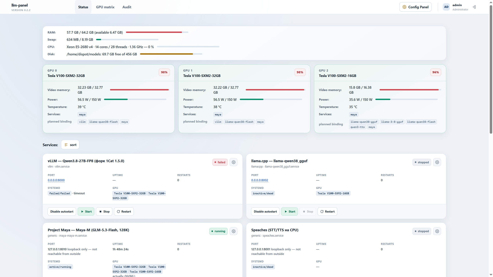

# llm-panel — локальная веб-панель управления LLM-станцией

Веб-панель для сервера с LLM-сервисами: статусы и управление systemd-юнитами
(vLLM, llama.cpp, TTS/STT, вспомогательные), сводка GPU/RAM/CPU/дисков, журналы
с маскированием секретов, аудит действий. **Универсальна**: конкретные юниты,
GPU, диски и пользователь задаются конфигурацией и параметрами установщика, а не
кодом — проект ставится на любой сервер с systemd (NVIDIA GPU опционален).



**Статус: этап 3 (из 4) начат, версия 0.3.0.** Готовы: этап 1 (MVP) целиком,
этап 2 частично (матрица GPU, редактор конфигураций с версиями/diff/rollback),
начало этапа 3 — каталог моделей. Далее: HF-загрузки, мастер «модель → сервис»,
Open WebUI-интеграция.

## Документация

| Документ | Содержание |
|---|---|
| [docs/PROJECT.md](docs/PROJECT.md) | описание проекта: возможности, архитектура, безопасность, конфигурация, Панель настроек, этапы |
| [docs/DEPLOY.md](docs/DEPLOY.md) | развертывание на любом сервере: install.sh / вручную, настройка юнитов/GPU/дисков, Caddy, обновление, аварийные процедуры |
| [docs/STATION-LLM.md](docs/STATION-LLM.md) | факты обследования и история первой станции (конкретный сервер) |
| [docs/UNITS.md](docs/UNITS.md) | добавление systemd-юнитов в панель (системные и user-юниты) |

## Возможности этапа 1

- Вход по паролю (Argon2), блокировка после 5 неудач, CSRF, строгий CSP (без inline script/style).
- Дашборд: карточки сервисов (статус systemd, health, автозапуск, uptime, GPU-привязка),
  блок хоста (RAM/swap/CPU/диски), карточки GPU (загрузка, память, температура, питание, процессы).
- Управление start/stop/restart и автозапуском — только через root-owned helper
  с allowlist (sudoers даёт право ровно на один путь; юнит вне allowlist = отказ).
- Журналы юнитов: просмотр/скачивание с маскированием `hf_…`/JWT/Bearer/sk-ключей;
  живой поток (SSE) с фильтром по строке.
- Ручной порядок карточек (перетаскивание мышью, сохраняется в БД).
- SSE-обновления от одного общего коллектора (интервал 2–10 с, настраивается в UI).
- Панель настроек `/config`: язык EN/RU, °C/°F, интервал обновления, лимит аудита,
  пути дисковой сводки — всё применяется на ходу, без рестарта.
- Добавление юнитов из UI (системные и user-юниты, «Поиск сервисов»), скрытие карточек.
- Фактические данные без yaml: GPU по процессам (NVML-атрибуция), слушающие порты,
  авто-TCP-health — для юнитов без описания привязок (v0.1.12).
- GPU/CPU/RAM определяются автоматически (NVML + psutil); «нет данных» вместо выдумок.

## Возможности этапа 2 (реализовано частично)

- **Матрица GPU** (`/matrix`, только просмотр): плановые привязки карт из
  services.yaml против фактической занятости (NVML-процессы); сниппеты привязки
  по конвенции владельца (`CUDA_VISIBLE_DEVICES` по индексам/UUID, `"gpu": [...]`
  для Maya); сервисы без привязки — отдельная приглушённая секция.
- **Конфликты** (advisory): карта запланирована нескольким сервисам; фактическое
  совладение карты; одновременная работа ≥2 сервисов с `ram_exclusive`; один порт
  у работающих сервисов.
- **Редактор конфигураций** (`/config/files`): правка dispot-owned конфигов
  движков (например `maya-maya-m.json`) прямо из панели — JSON-валидация до
  записи, атомарная запись, история версий в SQLite, diff против текущего,
  откат (тоже версией). Root-owned файлы (`/etc/llm-panel`, systemd-юниты)
  не редактируются — по ТЗ. Все действия в аудит.
- Порт юнита в карточке — ссылка в новой вкладке (хост панели : порт юнита);
  для loopback-only привязок ссылка не даётся.

## Структура

```
llm-panel/
├── llm_panel/                  код панели (FastAPI, Jinja2, SQLite, NVML+psutil)
├── deploy/
│   ├── install.sh              универсальный установщик (--user/--dir/--config-dir/...)
│   ├── llm-panel.service.template  шаблон systemd-юнита панели
│   ├── helper/llm-panel-systemd    root-owned helper
│   ├── *.example               шаблоны config/services/allowlist
│   ├── sudoers.llm-panel       предложение sudoers (одна строка на helper)
│   └── examples/               реальные примеры заполнения (станция-LLM)
├── scripts/survey*.sh          read-only обследование сервера
├── docs/                       PROJECT.md, DEPLOY.md, STATION-LLM.md, UNITS.md
├── tests/                      pytest
└── config.dev.yaml             конфиг машины разработки
```

## Локальная разработка (Windows/Linux без systemd)

```bash
python -m venv .venv
.venv/Scripts/pip install -r requirements.txt          # Linux: .venv/bin/pip
.venv/Scripts/python -m llm_panel --config config.dev.yaml init-db
.venv/Scripts/python -m llm_panel --config config.dev.yaml set-password
.venv/Scripts/python -m llm_panel --config config.dev.yaml serve
# открывать http://localhost:8000  (SSE/статусы systemd будут «нет данных»)
```

Тесты: `.venv/Scripts/python -m pytest tests -q` (170 тестов).

## Установка на сервер

```bash
sudo bash deploy/install.sh --user <пользователь-панели>
```

Полная инструкция — [docs/DEPLOY.md](docs/DEPLOY.md): обследование сервера,
заполнение `services.yaml`/`allowlist.json` под свои юниты, sudoers (отдельное
подтверждение), Caddy, обновления, аварийные процедуры.
